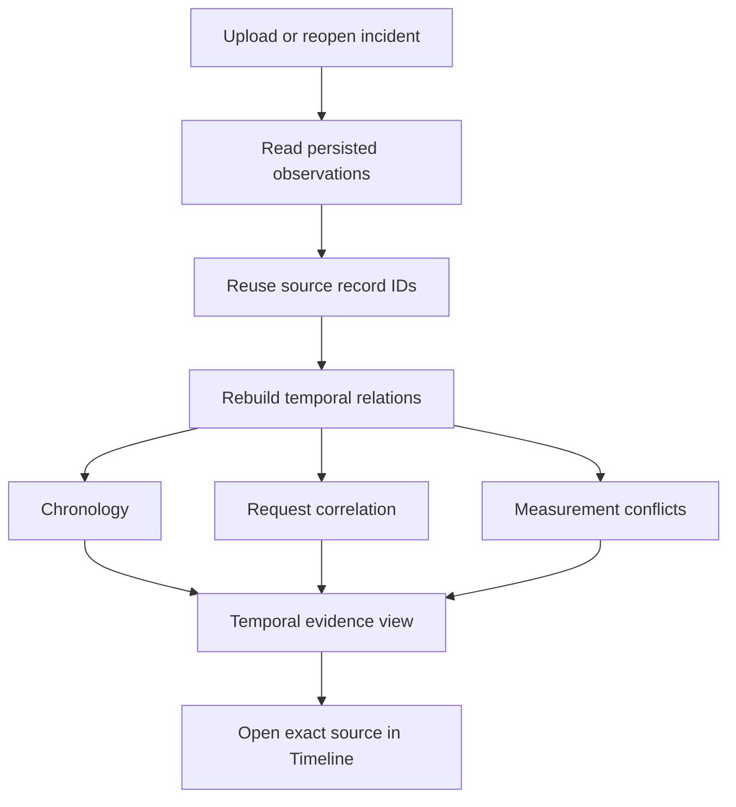

# LogMind-X: Temporal Heterogeneous Evidence Graph

## Overview (Objective 1)

The session graph projects the same SQLite observations used by Timeline and chat citations. Each log, metric sample, change, or screenshot panel uses its persisted observation ID and exact source location. Ingest rebuilds temporal relations automatically. Opening an existing incident calls finalization to rebuild records uploaded before this graph was introduced.

Time order, request correlation, measurement conflicts, and declared dependencies each have explicit relation labels. Root-cause decisions use the incident verifier's checks for competing hypotheses.

---

## Node Schema

| Node Type | Source | Attributes | Semantics |
|---|---|---|---|
| `service` | Graph topology | `service`, `type="service"` | Service identity in the architecture |
| `database` | Graph topology | `service`, `type="database"` | Storage or persistence layer |
| `ObservationLog` | Log records | `service`, `timestamp`, `severity`, `correlation_id`, `request_id`, `modality="log"`, `summary` | Point-in-time application log entry |
| `Deployment` | Change logs / events | `service`, `timestamp`, `modality="change"`, `summary` | Operational deployment event |
| `ConfigChange` | Config / pool changes | `service`, `timestamp`, `modality="change"`, `summary` | Runtime configuration change |
| `Metric` | Time-series metrics | `service`, `timestamp`, `modality="metrics"`, `anomaly`, `metric_values` | Metric measurement window |
| `Screenshot` | Extracted screenshot panel | `service`, `timestamp`, `raw_timestamp`, `source_label`, `modality="image"` | Visible monitoring evidence with its panel label |

Observation nodes include `observation_id`, `source_file`, `source_position`, `summary`, and `utc_timestamp`. Numeric timestamps are UTC epoch seconds. Missing or timezone-free timestamps remain null. A screenshot with a visible range retains that text in `raw_timestamp`. Explicitly dated timezone-aware ranges use `interval_start` and `interval_end`, while `utc_timestamp` remains null. Their canvas position uses the start bound and their card identifies them as ranges. Typed readings retain units and sample/maximum/minimum/last aggregation. A range cannot be treated as an instantaneous maximum.

---

## Edge Schema & Semantics

| Edge Relation | Color / Label | Generation Logic | Causal Meaning |
|---|---|---|---|
| `precedes` | Amber (`#f59e0b`) | Links observations on the same service to the first record whose start is strictly later than the source record's end (or point timestamp). Overlapping intervals do not establish order. | Strict time ordering. Equal timestamps cannot establish precedence. |
| `propagates_to` | Indigo (`#818cf8`), Request observed at target | An explicit `target_service` and a later target observation share the same request or correlation identifier within 30 seconds. | Observed request flow from caller to target. |
| `supports` | Emerald (`#10b981`), Shared request | Observations from different modalities share the same identifier field and value within 30 seconds and belong to different provenance groups. | Correlation across records. |
| `contradicts` | Red (`#ef4444`), Conflicting readings | Point measurements (excluding range aggregates) of the same field on the same service at the exact same timestamp disagree beyond rounding tolerance. | A measurement conflict to inspect in the source records. |
| `depends_on` | Soft blue (`#98b9ff`) | Static dependency topology between services. | Architecture call graph. |
| `has_observation`| Slate (`#64748b`) | Connects a `service` node to its point-in-time observation nodes. | Service provenance. |

---

## Window Parameters

- **`SUPPORT_WINDOW_S = 30.0`**: Two observations across modalities (e.g. log and metric) must occur within 30 seconds of each other with matching correlation identifiers to form a `supports` edge.
- **`CONTRADICT_WINDOW_S = 0.0`** requires the same recorded instant for a measurement conflict. Numeric readings use relative tolerance `0.001` and absolute tolerance `1e-6` to allow rounding.
- Identifier fields retain their names, so `request_id=123` and `correlation_id=123` belong to distinct groups. Numeric identifier values are excluded from metric measurements.

---

## Ingestion & Pipeline Flow

---

## UI Visualization

In the **Graph** view of the LogMind console:
- **Scope selector**:
  - `Temporal evidence` shows observation nodes and the four temporal relations. Records with unknown time stay visible with their source links.
  - `Dependency graph`: Standard call architecture (`depends_on`).
  - `Impact path`: Propagation path from suspected origin.
  - `All relationships`: Complete heterogeneous graph.
- **Edge rendering**:
  - The canvas legend displays each relation's label and color. Selecting an observation exposes its summary and source link.
  - Temporal records use lanes grouped by service and input type, with UTC event order running left to right. The spacing between columns represents event order. Record labels appear on selection or when zoomed in.
  - Node positions stay fixed in the temporal view. Background panning, zoom, selection, and source navigation remain available.
  - The record browser searches service names, UTC timestamps, source locations, and record summaries. Selecting a result centers it while retaining the zoom. The wider relationship graph highlights the selected record's connections.

## Rebuild and retry behavior

`POST /api/sessions/{id}/finalize` rebuilds the projection and returns current relation totals. It replaces provisional log nodes created by the earlier ingestion code and recomputes adjacency when late events arrive. Re-uploading identical files preserves record IDs and graph counts. Per-session locks serialize graph mutations across Linux server processes and threads, and atomic graph-file replacement protects readers from partial writes.

Multiple relations between one observation pair are retained in the persisted DiGraph's `temporal_relations` map. The graph API emits an individual edge for each relation. A pair can carry both `precedes` and `supports`.

Graph integration is covered by the backend tests. Desktop and mobile interaction checks remain part of the walkthrough in [TESTING.md](../TESTING.md).

## Time scope and provenance

Chat can use Timeline's service and UTC bounds. Keyword retrieval, semantic source resolution, lookup aggregates, and the bounded dependency hop apply the same window. Dated chart ranges match when they overlap that window. Unknown times stay outside bounded searches. The active verifier still requires point samples for baseline/saturation checks.

`stream_id` is an explicit telemetry lineage declaration. A matching screenshot and export share `provenance_group=stream:<id>`. Otherwise byte-identical uploaded versions share `file:<digest>`. Citation identities remain separate. Equal numbers alone cannot establish shared lineage. Shared groups do not gain independent cross-modal support, and the generation packet includes provenance and uncertainty.

Metadata and chat use atomic JSON publication under a process-shared state lock. The session index is rebuilt from metadata after an interrupted index write. Chat reset increments a generation so older in-flight replies cannot restore cleared history. SQLite writes use transactions and graph publication uses atomic replacement under an incident lock.
