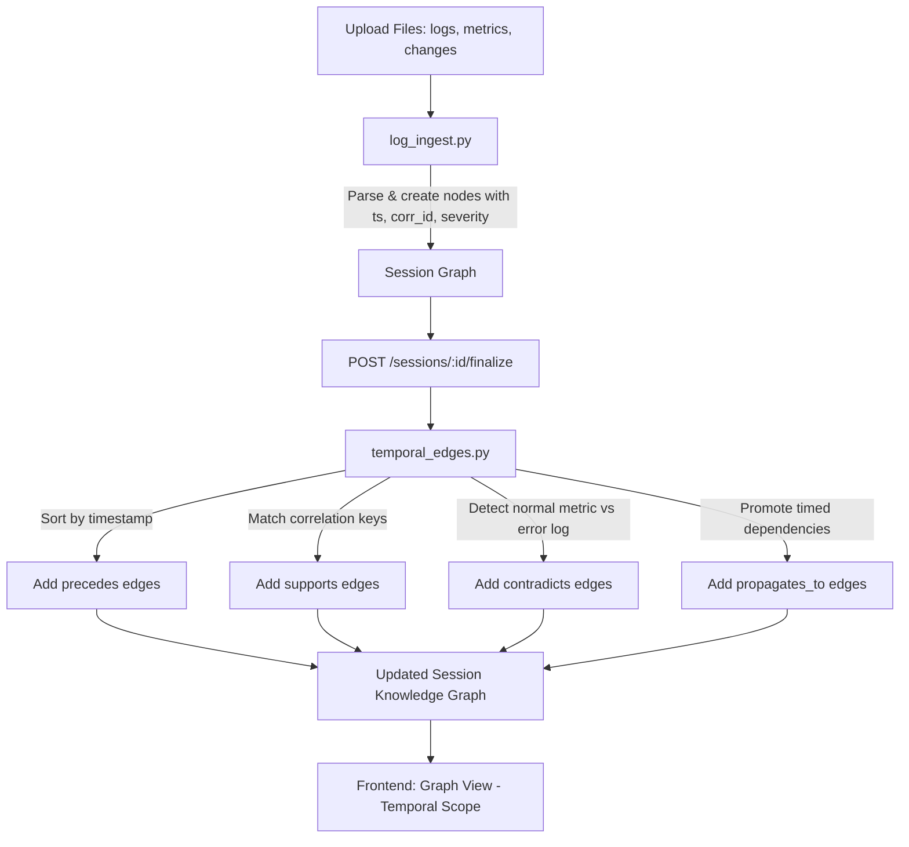

# LogMind-X: Temporal Heterogeneous Evidence Graph

## Overview (Objective 1)

Traditional observability tools link microservices and events via static connectivity alone (e.g. `depends_on`). This introduces critical blind spots when analyzing distributed incidents:
1. **Direction of causality** is lost when only service-level dependencies are tracked.
2. **Coincidental vs. causally preceding events** cannot be distinguished.
3. **Cross-modal corroboration** (e.g. metric spike confirming an error log) is missed.
4. **Contradictions** (e.g. a healthy metric conflicting with an error log) go undetected.

**LogMind-X** solves this by establishing a **session-scoped temporal heterogeneous evidence graph** that links services, observations (logs, metrics, dashboard signals), and operational changes (deployments, config changes, feature flags) with time-aware relations.

---

## Node Schema

| Node Type | Source | Attributes | Semantics |
|---|---|---|---|
| `service` | Graph topology | `service`, `type="service"` | Service identity in the architecture |
| `database` | Graph topology | `service`, `type="database"` | Storage or persistence layer |
| `ObservationLog` | Log records | `service`, `timestamp`, `severity`, `correlation_id`, `request_id`, `modality="log"`, `summary` | Point-in-time application log entry |
| `Deployment` | Change logs / events | `service`, `timestamp`, `modality="change"`, `summary` | Operational deployment event |
| `ConfigChange` | Config / pool changes | `service`, `timestamp`, `modality="change"`, `summary` | Runtime configuration change |
| `Metric` | Time-series metrics | `service`, `timestamp`, `modality="metrics"`, `anomaly`, `metric_values` | Metric measurement window |

---

## Edge Schema & Semantics

| Edge Relation | Color / Label | Generation Logic | Causal Meaning |
|---|---|---|---|
| `precedes` | Amber (`#f59e0b`) | Connects consecutive observations of the same service in chronological order: $t(A) < t(B)$. | Establishes time ordering: event A happened before event B. |
| `propagates_to` | Indigo (`#818cf8`) | Promoted from `depends_on` when target service call occurs at timestamp $t$. | Explicit downstream causal propagation during the incident. |
| `supports` | Emerald (`#10b981`) | Emitted when two nodes of **different modalities** share `correlation_id` or `request_id` within `SUPPORT_WINDOW_S` (30s). | Multi-modal cross-verification of an anomaly. |
| `contradicts` | Red (`#ef4444`) | Emitted when an `ERROR` log and a non-anomalous metric co-exist for the same service within `CONTRADICT_WINDOW_S` (60s). | Conflicting telemetry signals that downgrade confidence. |
| `depends_on` | Soft blue (`#98b9ff`) | Static dependency topology between services. | Architecture call graph. |
| `has_observation`| Slate (`#64748b`) | Connects a `service` node to its point-in-time observation nodes. | Service provenance. |

---

## Window Parameters

- **`SUPPORT_WINDOW_S = 30.0`**: Two observations across modalities (e.g. log and metric) must occur within 30 seconds of each other with matching correlation identifiers to form a `supports` edge.
- **`CONTRADICT_WINDOW_S = 60.0`**: Opposing observations (such as error logs and normal metrics) within 60 seconds are linked via `contradicts`.

---

## Ingestion & Pipeline Flow

---

## UI Visualization

In the **Graph** view of the LogMind console:
- **Scope selector**:
  - `Temporal Evidence`: Isolates only `precedes`, `supports`, `contradicts`, and `propagates_to` edges.
  - `Dependency graph`: Standard call architecture (`depends_on`).
  - `Impact path`: Propagation path from suspected origin.
  - `All relationships`: Complete heterogeneous graph.
- **Edge rendering**:
  - Edge labels display `precedes`, `supports`, `contradicts`, or `propagates to`.
  - Color-coding enables instant visual recognition of cross-modal support (green) and contradictions (red).

